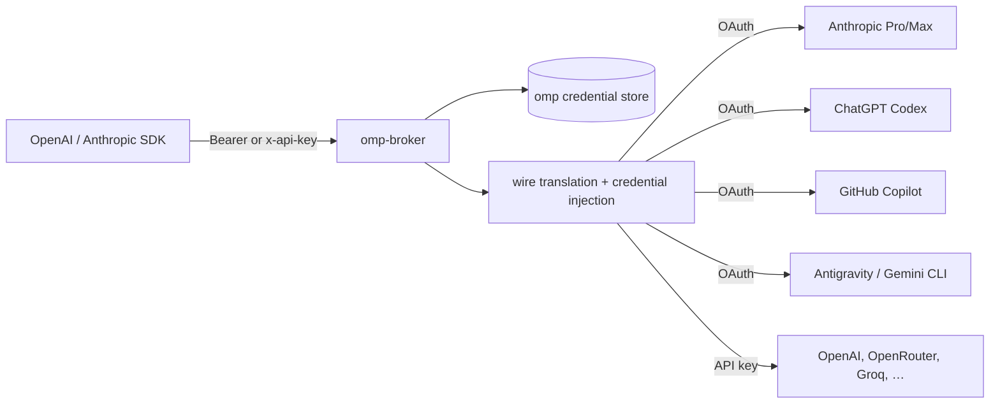

# omp-broker

OpenAI- and Anthropic-compatible HTTP gateway backed by [omp](https://omp.sh) subscription logins. One process, one bearer token, any client that speaks `/v1/chat/completions`, `/v1/messages`, or `/v1/responses` — routed through `@oh-my-pi/pi-ai` to the provider account you already log in with.



The gateway never exposes upstream access tokens to clients. It resolves `model` → provider → credential, refreshes OAuth when needed, translates the wire format, and streams the provider response back in the client's protocol.

## Quick start

Requires Bun ≥ 1.4.4.

```bash
bun install

# Authenticate a subscription (or reuse credentials already stored by omp)
bun run login openai-codex
# other examples: anthropic, github-copilot, google-gemini-cli, google-antigravity

# Start the gateway (second terminal)
bun run serve

# Fetch the bearer token and call it
TOKEN=$(bun run token)
curl -s http://127.0.0.1:4000/v1/chat/completions \
  -H "Authorization: Bearer $TOKEN" \
  -H "Content-Type: application/json" \
  -d '{"model":"openai-codex/gpt-5.6-sol","messages":[{"role":"user","content":"Say hi"}]}'
```

Anthropic Messages, using the same token in the native `x-api-key` header:

```bash
curl -s http://127.0.0.1:4000/v1/messages \
  -H "x-api-key: $TOKEN" \
  -H "anthropic-version: 2023-06-01" \
  -H "Content-Type: application/json" \
  -d '{"model":"github-copilot/claude-sonnet-4.5","max_tokens":128,"messages":[{"role":"user","content":"Say hi"}]}'
```

### SDKs

```ts
// OpenAI
const openai = new OpenAI({
  baseURL: "http://127.0.0.1:4000/v1",
  apiKey: process.env.OMP_BROKER_TOKEN,
});

// Anthropic (sends x-api-key)
const anthropic = new Anthropic({
  baseURL: "http://127.0.0.1:4000",
  apiKey: process.env.OMP_BROKER_TOKEN,
});
```

## Models

`GET /v1/models` lists chat models from providers that currently have a credential. Each row is `provider/model`; use that exact id, or the bare model id when only one authenticated provider exposes it.

```bash
bun run models                 # authenticated providers only
bun run models --all           # full bundled catalog
bun run models --provider anthropic
```

Bare ids resolve through a fixed preference order (`anthropic`, `openai-codex`, `github-copilot`, `google-antigravity`, `google-gemini-cli`, then the other authenticated providers). Override it with `OMP_BROKER_PROVIDER_ORDER=a,b,c`. Unknown ids return `404`; a known model without a credential returns `401` with the provider name.

## Frontend

`web/` is a Vite + React 19 console wired to the [Arc](https://uiarc.dev) component registry. Arc items are copied into `web/src/components/arc`, not installed as an npm package.

```bash
cd web
bun install
bun run dev      # http://127.0.0.1:5173
bun run build    # typecheck + production bundle
```

The shell follows the Circle/Linear layout: a 244px shadcn sidebar, Geist typography, 6px panel radii, bordered metric and activity grids, and Arc widgets for cards, charts, the activity heatmap, and the timeline. The usage widget is Bencho's StackedBars. Metrics, charts, usage, and activity currently use deterministic preview data while the logs page is being built; the gateway status badge polls `/healthz` for real state.

Add more items from `web/` with the shadcn CLI, for example `bunx shadcn@latest add @uiarc/dialog`. The registry is declared in `web/components.json`. The gateway does not serve the bundle; run the dev server, or host `web/dist` separately.

## Commands

| Command                     | Purpose                                                   |
| --------------------------- | --------------------------------------------------------- |
| `bun run serve`             | Start the gateway on `127.0.0.1:4000`                     |
| `bun run login <provider>`  | OAuth or API-key login, persisted to the credential store |
| `bun run logout <provider>` | Remove one provider's stored credentials                  |
| `bun run logout --all`      | Remove every stored credential (confirmation required)    |
| `bun run status`            | Show stored credentials, accounts, and token expiry       |
| `bun run providers`         | List providers available for login and which are stored   |
| `bun run models`            | List served models                                        |
| `bun run token`             | Print the gateway bearer token                            |
| `bun run healthcheck`       | Probe the local `/healthz` endpoint                       |

Useful flags: `--bind host:port`, `--token`, `--no-auth`, `--db path`, `--isolated`, `--omp`, `--agent-dir path`, `--manual`, `--json`, `--regenerate`, `--all`, `--yes`.

### Login

```bash
bun run login anthropic          # OAuth, prints URL / device-code instructions
bun run login openai-codex
bun run login github-copilot
bun run login openrouter         # API key providers prompt for the key
bun run login anthropic --manual # also accept a pasted redirect URL/code
```

When the provider uses a loopback callback, the flow prints the URL; open it on any machine that can reach the callback port (SSH-forward the port when the gateway runs remotely). `--manual` adds a paste prompt for headless setups.

## Credential storage

By default the gateway uses the same credential store as omp: `~/.omp/agent/agent.db`, or the remote auth-broker when `~/.omp/config.yml` / `OMP_AUTH_BROKER_URL` configures one. Existing `omp login` subscriptions therefore work immediately, and logins made through `omp` and this CLI are interchangeable. The gateway polls the store every five seconds, so a login in another process is picked up without a restart.

| Mode          | Selection                                  | Location                                        |
| ------------- | ------------------------------------------ | ----------------------------------------------- |
| omp (default) | nothing / `--omp`                          | `~/.omp/agent/agent.db` or configured broker    |
| isolated      | `--isolated` or `OMP_BROKER_STORAGE=local` | `~/.omp-broker/auth.db`                         |
| explicit      | `--db path` or `OMP_BROKER_DB`             | `path`                                          |
| container     | image defaults                             | `/data/auth.db` on the `omp-broker-data` volume |

`--agent-dir` targets another omp profile. `PI_CODING_AGENT_DIR` is honored by omp's discovery as usual. The container image sets `OMP_BROKER_STORAGE=local` and an explicit `/data/auth.db`, so it never reads the host's omp store.

## Endpoints

| Method | Path                    | Notes                                           |
| ------ | ----------------------- | ----------------------------------------------- |
| POST   | `/v1/chat/completions`  | OpenAI chat-completions, streaming or JSON      |
| POST   | `/v1/messages`          | Anthropic Messages, streaming or JSON           |
| POST   | `/v1/responses`         | OpenAI Responses                                |
| POST   | `/v1/pi/stream`         | Native pi-ai event stream                       |
| GET    | `/v1/models`            | Models with credentials                         |
| GET    | `/v1/usage`             | Provider quota/usage for authenticated accounts |
| GET    | `/v1/credentials/check` | Per-credential auth probe                       |
| GET    | `/v1/logs`              | Recent requests (`limit`, `before`)             |
| GET    | `/v1/logs/stats`        | Dashboard aggregates (`days`, 1–30)             |
| GET    | `/healthz`              | Unauthenticated liveness                        |

Auth accepts `Authorization: Bearer <token>` and Anthropic's `x-api-key: <token>`. CORS preflight is handled for browser clients.

### Request logs

Every handled request is recorded in `$OMP_BROKER_HOME/requests.db` (SQLite, WAL). Health probes, CORS preflights, and the log routes themselves are excluded so the history reflects gateway traffic. The last 10,000 rows are kept by default; the writer prunes old rows in the background.

`GET /v1/logs` returns newest first with `limit` (1–200) and an exclusive `before` cursor. `GET /v1/logs/stats?days=7` returns a 24-hour summary (including token totals and cost), a daily series, 30-day endpoint usage, and per-route totals. Both routes require the gateway bearer token.

Entries contain the method, path, status, handling duration, client address, error text, requested model, resolved provider, response request id, stream flag, and usage buckets: input (non-cached), output, cache read, cache write, reasoning, total tokens, plus the notional catalog cost. Request and response bodies, headers, and credentials are never stored.

JSON responses have usage read before the row is written. SSE rows are written as soon as headers are ready and their token and cost columns are filled when the stream ends. OpenAI streams report usage only when the client requests `stream_options.include_usage`; Anthropic Messages and OpenAI Responses streams carry usage natively. For streaming responses the duration stops when the response is returned to the client, not when the stream ends.

## Build a standalone server

```bash
bun run build
# dist/omp-broker — one executable, native addon embedded

OMP_BROKER_TOKEN=change-me ./dist/omp-broker serve --bind=0.0.0.0:4000
```

The build uses `--aot --trim --minify` and embeds a zstd-compressed `pi_natives` addon, producing a ~158 MB executable. On Linux most of the reduction currently comes from compression rather than `--trim`; both flags are wired in for newer Bun runtimes. The first run extracts the addon into `$OMP_BROKER_HOME/natives/<version>/` (~107 MB), then reuses it. Override the location with `PI_NATIVES_DIR`. Build on the target OS/architecture — Bun does not cross-compile the N-API addon.

## Docker

```bash
docker compose build
docker compose up -d
docker compose exec omp-broker omp-broker token
```

The image is multi-stage and runs on distroless Debian 12 as UID 10001, with no shell or Bun runtime. It is about 99 MB compressed. All state lives on the `omp-broker-data` volume:

```text
/data/auth.db        credential SQLite database (isolated from the host)
/data/requests.db    request history (SQLite, WAL)
/data/broker.token   generated gateway bearer token
/data/natives/       extracted pi_natives addon
```

The container does not mount or read `~/.omp/agent/agent.db`. Log in inside the container, or publish the provider's OAuth callback port for the login run:

```bash
docker compose exec -it omp-broker omp-broker login openai-codex --manual
# or, for a callback flow:
docker compose run --rm --service-ports -p 1455:1455 omp-broker login openai-codex
```

Compose publishes `127.0.0.1:4000` only; put TLS and auth-aware reverse proxy in front for remote clients. To use a bind mount instead of the named volume, `chown 10001:10001` the host directory. Rotate the token with `docker compose exec omp-broker omp-broker token --regenerate`.

## Configuration

| Variable                     | Default                        | Purpose                                     |
| ---------------------------- | ------------------------------ | ------------------------------------------- |
| `OMP_BROKER_BIND`            | `127.0.0.1:4000`               | Listen address                              |
| `OMP_BROKER_TOKEN`           | token file                     | Bearer token override                       |
| `OMP_BROKER_HOME`            | `~/.omp-broker`                | Token (and isolated DB) directory           |
| `OMP_BROKER_DB`              | —                              | Explicit credential SQLite path             |
| `OMP_BROKER_STORAGE`         | `omp`                          | `omp` or `local`                            |
| `OMP_BROKER_AGENT_DIR`       | —                              | omp agent/profile directory                 |
| `OMP_BROKER_PROVIDER_ORDER`  | see Models                     | Comma-separated bare-id provider preference |
| `OMP_BROKER_LOG_DB`          | `$OMP_BROKER_HOME/requests.db` | Request history SQLite path                 |
| `OMP_BROKER_LOG_MAX_ENTRIES` | `10000`                        | Rows kept before old requests are pruned    |
| `PI_NATIVES_DIR`             | `$OMP_BROKER_HOME/natives`     | Extracted native addon directory            |

The token lives at `$OMP_BROKER_HOME/broker.token` (mode `0600`) and is generated on first use. In the container that is `/data/broker.token`. `bun run token --regenerate` replaces it; an env or `--token` value always takes precedence.

## Troubleshooting

- `401 unauthorized` — the client token differs from `bun run token`; an env or `--token` override may be winning.
- `401 No credential available for provider …` — log in to that provider, or pick a model from an authenticated provider.
- `404 Unknown model` — model ids are case-sensitive in requests; use the exact `provider/model` row from `GET /v1/models`.
- GitHub Copilot returns `model_not_supported` — enable the model in VS Code's Copilot model picker first; the subscription only exposes enabled models.
- Remote OAuth callback never completes — forward the printed loopback port over SSH, or rerun `bun run login <provider> --manual` and paste the redirect URL.

## Security notes

- Binds to loopback by default. Put TLS and network policy in front of it before exposing it.
- The Docker image runs non-root on distroless; only `/data` is writable.
- `--no-auth` is refused on non-loopback binds unless `--allow-remote` is passed.
- Tokens, refresh tokens, and API keys are never written to logs or responses; upstream auth is injected server-side.
- Request logs store request metadata (path, status, duration, client, model, provider, token buckets, cost), never headers, bodies, or credentials, and the log routes require the gateway bearer.
- OAuth subscription endpoints are sanctioned for their providers' own clients. Check your provider's terms before sharing access with other users or workloads.

## Development

```bash
bun test        # protocol round-trips against a mock upstream + catalog tests
bun run check   # tsc --noEmit
bun run fmt     # Oxfmt via Vite+
bun run lint    # Oxlint via Vite+
```

`bun run fmt:check` verifies formatting without writing; lint and format settings live in `vite.config.ts`.

The e2e test starts the real Bun server with injected `fetch`, exercises OpenAI chat (JSON + SSE), Anthropic Messages (JSON with `x-api-key`), OpenAI Responses, auth failures, model listing, and the request log routes.

## Library use

The modules under `src/` are importable from Bun:

```ts
import { openStorage } from "./src/storage";
import { startGateway } from "./src/server";

const { storage } = await openStorage({ isolated: true });
const gateway = await startGateway({ storage, bearerTokens: ["secret"] });
console.log(gateway.url);
```
